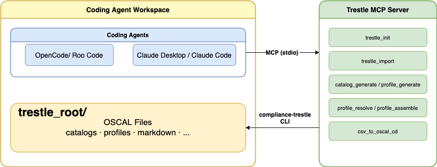
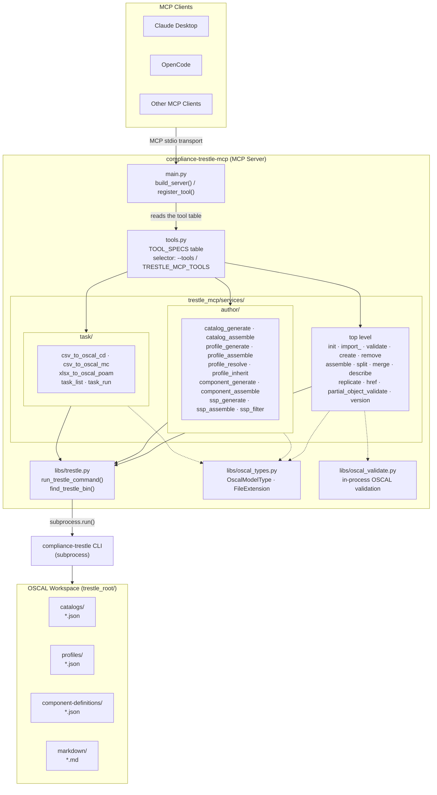
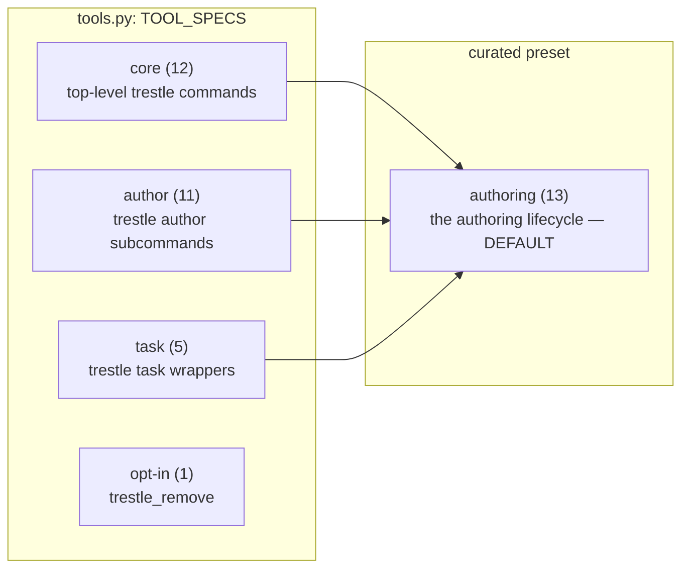
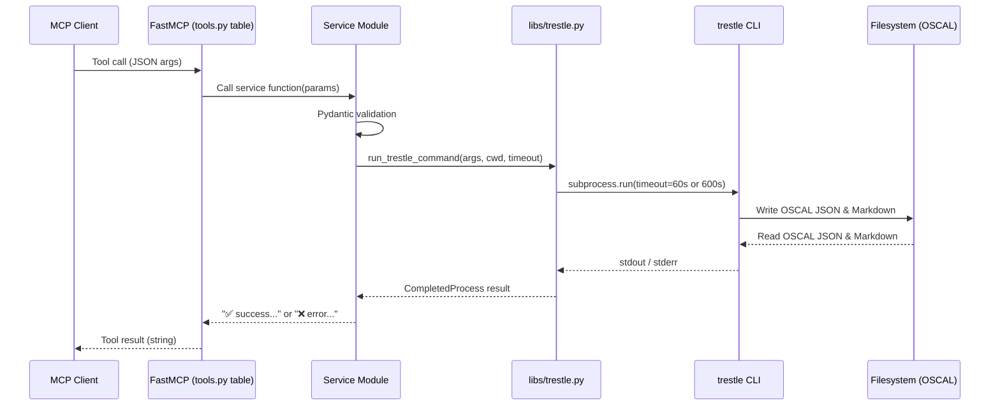
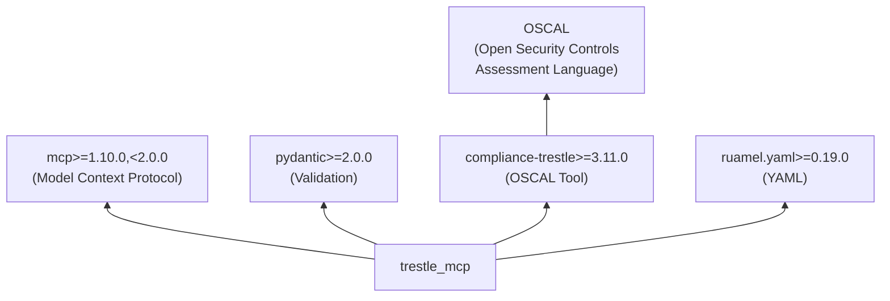

# Architecture

## High-Level Overview

**compliance-trestle-mcp** is an [MCP (Model Context Protocol)](https://modelcontextprotocol.io/) server that bridges AI coding agents with [compliance-trestle](https://github.com/oscal-compass/compliance-trestle), an OSCAL-based compliance automation tool.

The coding agent workspace doubles as the `trestle_root` — the directory that compliance-trestle uses to store and manage OSCAL artifacts. This means the AI agent can read and edit OSCAL files (catalogs, profiles, component definitions, markdown control docs) directly alongside the MCP tools that operate on them.

**Request flow:**
1. The user asks the coding agent (OpenCode, Claude, etc.) to perform an OSCAL operation in natural language.
2. The coding agent calls the appropriate MCP tool exposed by the Trestle MCP Server.
3. The server translates the call into a `compliance-trestle` CLI command and runs it as a subprocess.
4. The CLI reads from and writes to the `trestle_root/` directory inside the workspace.

## System Overview

The server is structured around a thin service layer. Each MCP tool has a dedicated service module under `trestle_mcp/services/` that validates inputs via Pydantic and constructs the appropriate CLI arguments.

Tools are **registered from a table, not from decorators**. `tools.py` holds one
`ToolSpec` row per tool, and `main.py` registers the subset a startup selector
picks out; FastMCP derives each tool's input schema from the service function's
`params` annotation and its description from the docstring. Which tools are
registered is decided by `--tools` or `TRESTLE_MCP_TOOLS` — see
[Choosing which tools are exposed](../README.md#choosing-which-tools-are-exposed)
and [what each selection costs](development/tool-context-cost.md).

All subprocess execution is centralized in `libs/trestle.py`, which locates the
`trestle` binary, runs it in the workspace named by `--trestle-root` so that a
relative path argument is relative to the workspace rather than to wherever the
client launched the server, waits for it on a worker thread so a slow command
does not stop the event loop, and applies a timeout: `DEFAULT_TIMEOUT` (60s) for
commands that only touch local models, and `LONG_TIMEOUT` (600s) for those that
fetch remote content, resolve a profile or walk a whole catalog. Twelve services
pass the longer one — `import`, the four `author` commands that resolve a
profile (`profile-resolve`, `profile-inherit`, `component-generate`,
`component-assemble`), the three SSP commands (`ssp-generate`, `ssp-assemble`,
`ssp-filter`) and the four `task` tools that run a task. `task_list` only reads
help text, so it keeps the default. Which tools these are is pinned by
`tests/unit/test_timeouts.py`.

One tool does not shell out at all: `trestle_validate` validates a standalone
OSCAL file in-process through `libs/oscal_validate.py`, so it works outside a
workspace.

## MCP Tools

The tool table in `tools.py` holds 29 tools. 28 of them can be selected by a
group; `trestle_remove` is reachable only by naming it, because it deletes model
content in place with no backup.

Groups are structural and mirror the trestle CLI's own command structure, so
which tool is in which group follows from the CLI rather than from a taxonomy
invented here. `authoring` is the one curated preset that cuts across them, and
is the default.

| Group | Tools | What it covers |
|---|---:|---|
| `core` | 12 | `init`, `import`, `validate`, `create`, `assemble`, `split`, `merge`, `describe`, `replicate`, `href`, `partial-object-validate`, `version` |
| `author` | 11 | every `trestle author` subcommand this server wraps: catalog, profile, component and SSP generate/assemble, plus `profile-resolve`, `profile-inherit` and `ssp-filter` |
| `task` | 5 | `csv-to-oscal-cd`, `csv-to-oscal-mc`, `xlsx-to-oscal-poam`, plus `task_list` and the generic `task_run` |
| `authoring` | 13 | the authoring lifecycle, cutting across the three above. **The default** |
| `all` | 28 | everything a group can select |
| opt-in | 1 | `trestle_remove`, registered only when named |

The per-tool list lives in two places that cannot drift from the code: the
[README tool table](../README.md#tool-list--quick-reference) for the default
selection, and `TOOL_SPECS` in
[`trestle_mcp/tools.py`](../trestle_mcp/tools.py) for all of them. For the
trestle commands that deliberately have no tool — signing and provenance,
`beta`, and the non-OSCAL `author` document commands — see
[Commands deliberately not covered](development/README.md#commands-deliberately-not-covered).

## Data Flow

Tool handlers are all `async def` to support concurrent MCP calls. Errors are returned as formatted strings (never raised as exceptions) so the MCP client always receives a readable result — with one deliberate exception: input that cannot be a valid command, such as a task name that would be read as a CLI flag, fails Pydantic validation before the subprocess starts rather than producing a misleading success.

The `trestle task` tools (`csv_to_oscal_cd`, `csv_to_oscal_mc`, `xlsx_to_oscal_poam` and the generic `task_run`) write the INI configuration the task expects to a temporary file and remove it afterwards.

## Dependency Stack

`compliance-trestle-mcp` is intentionally a thin wrapper — it adds no OSCAL logic of its own. All compliance semantics live in `compliance-trestle`, keeping this package focused solely on exposing that functionality over the MCP protocol.
